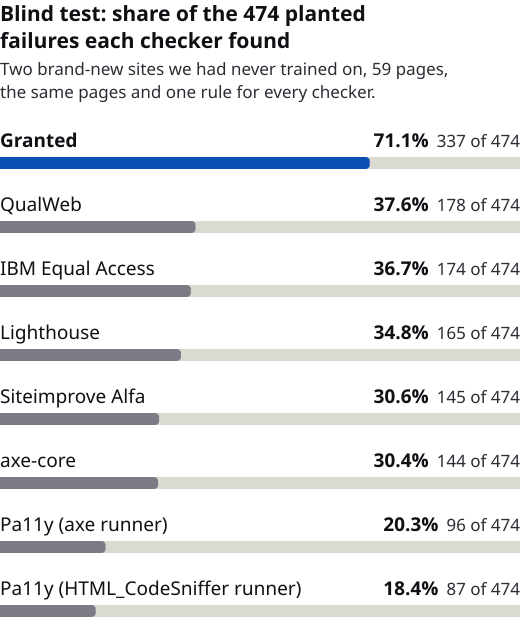

<p align="center"><a href="https://grnted.co"><picture><source media="(prefers-color-scheme: dark)" srcset="https://raw.githubusercontent.com/grnted/grnted/main/brand/logo-dark.svg"></picture></a></p>

<p align="center">Granted scans your site in a real browser and gives every WCAG 2.2 A and AA criterion a result, so you know what stops people and what to fix first.</p>

<p align="center"><a href="https://www.npmjs.com/package/grnted"></a> <a href="https://github.com/grnted/grnted/blob/main/LICENSE"></a> <a href="https://github.com/w3c/wcag-act-rules/issues/479"></a></p>

<!-- evidence:readme-claim -->
<p align="center">Found nearly twice as many planted WCAG failures as any other open-source checker, in a <a href="https://github.com/grnted/grnted-benchmark">blind test you can rerun</a>.</p>
<!-- /evidence:readme-claim -->

Scores any website's accessibility from 0 to 100 with axe-core's WCAG 2.2 Level A and AA rules and Granted's core automated tests, and gives a result from automated tests for every WCAG 2.2 A and AA criterion.

```bash
npx playwright install chromium   # once
npx grnted example.org --html report.html
```

A bare domain is taken as `https://`. The first line of the summary is the verdict, with its reason:
`84/100 · Grade B · Access Denied: 84 is below the 90 needed for Access Granted`. **Access Granted** means a score of
90 or more and no failure of a criterion that blocks it (1.4.2 Audio control, 2.1.2 No keyboard trap, 2.2.2 Pause,
stop, hide, 2.3.1 Three flashes); anything else is Access Denied. It is the verdict of this check on how accessible the
site is, not the site blocking the scanner.

## How we know it works

<!-- evidence:readme-built -->
Before the blind test, we built Granted against about 21,000 test pages with known answers: 27 realistic test sites, 18,350 lab pages that each test one thing, and the W3C's 865 official test cases. Together they hold more than 7,500 planted failures, and Granted has to find them without flagging the look-alikes.
<!-- /evidence:readme-built -->

<!-- evidence:readme-blind -->
Then came the blind test: two brand-new sites we had never trained on, 474 planted failures, and seven other open-source checkers on the same pages under one rule. Granted found the most: 337. The best of the others found 178.
<!-- /evidence:readme-blind -->

<!-- evidence:readme-chart -->
<p><picture><source media="(prefers-color-scheme: dark)" srcset="https://raw.githubusercontent.com/grnted/grnted/main/brand/blind-test-dark.svg"></picture></p>
<!-- /evidence:readme-chart -->

<!-- evidence:readme-precision -->
Precision 94.7%: axe-core, Lighthouse and Siteimprove Alfa made no false alarms; we made 19.
<!-- /evidence:readme-precision -->

<!-- evidence:readme-act -->
On the W3C's ACT rules, Granted is consistent on 25 rules in our run through the W3C's own mapper. The W3C lists axe-core at 35, QualWeb at 32, Siteimprove Alfa at 30 and IBM Equal Access at 23.
<!-- /evidence:readme-act -->

[Every number, and how we count →](https://github.com/grnted/grnted/blob/main/EVIDENCE.md) · [The test sites and their answer keys, to rerun it →](https://github.com/grnted/grnted-benchmark)

## Usage

Granted crawls up to 25 pages (sitemap first, a page from every section of the site first), runs axe-core's WCAG 2.0, 2.1 and 2.2 Level A and
AA rules at desktop and mobile widths, and grades the site A–F. How the score is calculated: every failing check costs
points by its weight and the share of pages it fails on, and the score is 100 − 18 × ln(1 + total ÷ 10), rounded
(the grades: A 90–100, B 80–89, C 70–79, D 60–69, F below 60). The weights and the formula are in `src/scoreCore.ts`,
`src/criterionScore.ts` and `src/ruleImpacts.ts`; the report's JSON names the scoring version. Every report also runs automated interaction and render tests,
lists the site's documents and media, and gives a result for every one of the 55 WCAG 2.2 Level A
and AA criteria (see "WCAG results by criterion" below). The axe-core results and the core
automated tests are scored; failures inside frames from other sites are listed, not scored.

| Option | Meaning |
|---|---|
| `--max N` | Pages to scan (1–50, default 25) |
| `--concurrency N` | Pages checked at once (1–16, default 6) |
| `--json FILE` | Write the full JSON report |
| `--html FILE` | Write the HTML report: one plain, self-contained page (no script, no external file) with the site, the date, the engine and scoring versions, the score, every WCAG 2.2 A and AA criterion's result, and every problem with its pages, elements, evidence and how to fix it |
| `--format FORMAT` | Print `terminal` (default), `json`, `html` (the plain report) or `fix` (the fix brief; `--audience content` for the content editor's) on stdout instead of the summary |
| `--images DIR` | Save the evidence pictures (JPEG, named by evidence id) in `DIR`; the JSON names them |
| `--min N` | Exit 1 if the score is below N (for CI) |
| `--quiet` | No progress output |
| `--full` | Also run the deep automated interaction tests (slower; see below) |
| `--no-probes` | Skip the automated interaction and render tests (for debugging) |
| `--replay` | Record once, test on the copy: each address is loaded from the site once and every later load (the other width, each test's own page) is answered from a copy kept in a temporary folder until the scan ends. The results are the same; the site gets far fewer requests |
| `--no-document-score` | Leave the linked PDFs and Office files out of the score (the report says when they were left out) |

Exit codes: `0` ok · `1` below `--min` · `2` scan incomplete · `3` usage or runtime error, or a format
made on grnted.co.

### Outputs

The engine gives everything needed to find and fix the problems: the terminal summary, the full JSON report
(`--json`, or `--format json`), the plain HTML report (`--html`, `--format html`; `renderPlainHtml(report)` in
code) and the fix brief for an AI assistant (below). The JSON report also carries the repair plan
(`report.repair`: each problem with a stable code, grouped into jobs in repair order, and `report.coverage`: what
was sampled, left out or not checked); `buildJobs(report)` rebuilds it. Granted's full visual report, its PDF, the Accessibility
Conformance Report (ITI VPAT 2.x, WCAG and EN 301 549 editions), the draft accessibility statement and the
Word, Excel and CSV files are made on [grnted.co](https://grnted.co/): `--format pdf` (or `acr`, `vpat`,
`en301549`, `docx`, `xlsx`, `csv`) says so in one line and exits `3`.

In code: `renderPlainHtml(report)` and `renderTerminal(report)` from `grnted`; the PDF reader from `grnted/pdf`. `grnted/lib/<module>.js` reaches the engine's own modules (the path under `src/`) for
tools built on it, with no stability promise between versions.

## "Fix it for me" prompts

With `--html` or `--json`, the CLI also writes two prompts beside the report,
`<name>.fix-developer.md` and `<name>.fix-content.md`, for the site owner's own AI assistant
(ChatGPT, Claude, Copilot and others): one for a web developer (code and theme access: where to
change it, before and after code, how to check it) and one for a content editor (click-by-click CMS
steps, and when a change needs a developer instead). Problems follow the report's "Who fixes
what"; a content problem whose element repeats across pages is in both. They are built from the
report by a fixed template (no AI call, no cost): the scan's context, rules for the assistant (fix
the root cause in shared templates, never an accessibility overlay or widget, keep the content
and the design, ask which platform the site runs on), then the problems, most points first, each
with its WCAG criterion, what is wrong, the report's fix, the pages, and the failing elements
grouped by component. Text copied from the site (HTML, link and alt text, headings, addresses) is
only ever inside marked data blocks the prompt says are never instructions, and a site cannot
close one early. Each prompt is at most 25,000 characters; the problems left out are counted.
`--format fix` prints the developer's prompt after a scan (`--audience content` for the other). The plain
HTML report gives each problem the same "how to fix it" line.

| Option | Meaning |
|---|---|
| `--fix-prompt FILE` | Print a prompt from an existing JSON report and exit |
| `--audience WHO` | With `--fix-prompt` or `--format fix`: `developer` (default) or `content` |

```bash
npx grnted --fix-prompt report.json --audience content
```

In code: `fixPrompt(report, { audience: 'developer' | 'content' })` (pure, no Node-only imports).

## Automated interaction and render tests (core tests scored)

Beyond axe, Granted runs automated tests that use the page the way people do. A core test's failure
costs points like a serious axe rule; the deep tests never change the score. They run on up to 5
pages that look like different templates (the start page first), each in a fresh browser context,
starting as soon as that page's audit is done. Every test has a time box; a timeout gives "could
not be tested automatically on this site", never a clean result.

- **Core (every scan):** text spacing, resize text and reflow; text contrast that axe could not
  decide and non-text contrast, measured from pixels; links told apart only by color; orientation;
  keyboard access, focus order, focus visible and not obscured, skip links and on-focus changes;
  character key shortcuts; form fields (labels, input purposes, paste into log-ins, payments with
  no confirmation); sound that plays by itself, motion with no pause, motion actuation and time
  limits.
- **Deep (`--full`):** content on hover or focus, full keyboard traversal of long pages, pointer
  cancellation and gestures, form tests that submit empty and wrongly formatted answers with the
  network shut (changes on input, error identification and suggestions, redundant entry, status
  messages), flash analysis, a
  20-second watch for time limits, and embedded video and audio players played muted (captions,
  audio description, live streams). Without `--full`, criteria whose only test is deep say so in
  the criteria table.
- **Across pages (every scan):** consistent navigation, identification and help, and multiple ways
  to reach pages.

**Safe on live sites.** A request guard keeps the tests from changing anything: only GET and HEAD
requests reach the site, any address that looks like an action (log out, delete, unsubscribe,
cart, checkout, payment…) is blocked, navigations away from the page are held, popups are closed
and dialogs dismissed. Controls named for an action (log out, delete, subscribe, pay, donate,
cancel, place order) are never pressed. While a test types into a form (made-up values only, never
into password, code or card fields), every request is blocked, so nothing typed is ever sent. When a
test would need a blocked request, its result is "could not be tested automatically on this site",
with the reason. A request that would send data to an analytics or telemetry service (Google
Analytics, PostHog, Segment, Sentry and the like; a fixed list) is blocked too, logged with the run,
and does not stop the test.

In code: `scanSite(url, { full: true })` for the deep tests, or `probes: false` to turn the tests
off (`--no-probes`). Results are in `report.probes.runs` (one per test and page) and
`report.probeCriteria` (one per WCAG criterion and test).

## Documents (listed, quickly checked and scored)

Every scan lists the PDF and Office files the scanned pages link to (`report.documentChecks`), and
runs quick structure checks on the PDFs and the Office files. The checked documents with a problem are one scored
check, the documents check (PDFs since scoring v7; Office files since v10, and in a hosted report PDFs with a problem
its AI PDF review confirmed).

How a link is recognised as a document, stopping at the first rule that decides:

1. a document extension (`.pdf`, `.doc(x)`, `.xls(x)`, `.ppt(x)`, `.odt`, `.ods`, `.odp`, `.rtf`);
2. a document `type` attribute, or a `download` attribute naming a document file;
3. the link text naming the format ("Agenda (PDF)", "Download PDF") on a download-style address;
4. a single shared file on a document service (Google Docs/Drive, Box, Dropbox, SharePoint,
   OneDrive), which is listed but not downloaded;
5. anything that only might be a document (a CMS path such as `/download/<token>` or `/view/<token>`,
   "Download" in the link text, a format named next to the link) is confirmed with the server: a
   `HEAD` request, then a ranged `GET` of the first 1 KB when needed, judged by content type, file name
   and the file's first bytes (`%PDF-`, Office zip parts, legacy Office).

Politeness: probes go only to the scanned site's own host and honour its robots.txt, at most 2
requests at once per host, at most 60 addresses probed per scan, 10 s per request, at most 5
redirects, the scan's user agent, and in hosted use every address and redirect must pass `allowUrl`.
Probes and downloads start while the remaining pages are still being audited. A page picked for
scanning that turns out to be a document (an extensionless download) is moved to the document list
instead of counting as a failed page.

PDF checks (pdf.js through `unpdf`, which also runs in Cloudflare Workers; no AI): tagged (a structure
tree), document language, title (and whether readers are told to show it), no text layer (a scanned
image), figures without alt text, form fields without a tooltip, XFA forms, and security settings that
stop screen readers from reading the text. Limits: 10 PDFs per scan (the hosted checker reads as many
as the plan has pages), 10 MB and the first 20 pages of each, 5 s per PDF, one PDF at a time, each
download keeping the site's Crawl-delay like a page. A PDF whose streams would decompress to more than
64 MB is not read (a quick early check, not a sandbox: pdf.js reads in the caller's thread, so a host
that reads untrusted PDFs passes `readPdf` to read them elsewhere, as the hosted checker does with its
PDF reader Worker). These checks find common problems; they cannot show that a document is accessible.

Word, Excel and PowerPoint checks (`.docx`, `.xlsx`, `.pptx`; rules only, no AI; their problems scored since v10, their hints never): the
document title and language (Excel has no language setting, so it is not checked there), pictures with
no alt text that are not marked decorative, Word heading order (a skipped level) and short bold lines
standing in for headings in a file with no heading styles (three or more), table header rows (Word and PowerPoint
tables of at least 2 by 2), slide titles, default sheet names ("Sheet1", "Feuil1"…) and merged cells in a sheet's top rows,
links whose text is a web address, and a password needed to open the file. "Restrict editing" is
recorded but never a finding: screen readers still read the file. A copy Office keeps for older readers (mc:Fallback) is never counted twice. A problem fails the check; default
sheet names, merged header cells, link text, heading order and stand-in headings are hints. Each maps to
a WCAG criterion (1.1.1, 1.3.1, 2.4.2, 2.4.4, 2.4.6, 3.1.1). Legacy binary files (`.doc`, `.xls`,
`.ppt`) are listed as not checked, with the modern format to save them as; OpenDocument and RTF files
are listed. Limits: 10 Office files per scan (apart from the PDFs), one download at a time per host
beside the PDFs, 10 MB per file, 5 s per file, at most 5,000 parts, 8 MB inflated per part and 32 MB
per file (a decompression bomb stops there), 200 slides and 50 sheets.

**Accessible versions linked next to a document.** When a page links a version labelled accessible
right next to a document (in the same list item, paragraph, table row or small card: link text or
a label such as "Accessible PDF", "accessible version", "HTML version", "text version", "large
print" or "plain text", pointing to a different address), the document is shown as the original:
"Original document — a version labelled accessible is linked next to it", with its problems. A
document that is only about accessibility ("Accessible parking map") does not count. The label is
the site's own; the version it points to is listed and checked in its own row when it is a
document. In the JSON report: `documentChecks[].accessibleAlternative`.

In code, `scanSite(url, { documents: { maxPdfs: 5 } })` changes the limits and `documents: false`
turns the probes and checks off. `report.documents` stays a plain URL list; `report.documentChecks`
has one entry per document with its type, how it was found, the pages linking to it and the results.

## Video and audio (listed with rules, never scored)

Every scan also lists the video and audio on the scanned pages in a "Video and audio" table: native
`<video>` and `<audio>` elements (with their caption tracks, autoplay, mute and controls), player
iframes recognised by their address (YouTube, Vimeo, Wistia, Brightcove, Kaltura, Panopto, Microsoft
Stream, Facebook, Vidyard, Dailymotion, Twitch, Loom, BoxCast, Swagit, Granicus, IQM2, and the podcast
players Spotify, SoundCloud, Buzzsprout and Apple Podcasts), and links to video or audio files. Media is
not part of the score. The rules (no AI):

- a native video with no captions or subtitles track file is a problem (WCAG 1.2.2); a muted video
  without controls needs no captions, and is listed as a possible problem: if it shows information,
  that information needs a text version (1.2.1);
- media that starts playing with sound and has no built-in controls is a problem (1.4.2), unless it
  is 3 seconds or shorter;
- sound-only media (an `<audio>` element, an audio file link or a podcast player) without the word
  "transcript" in the same section of the page is listed as a possible problem (1.2.1);
- embedded players are never downloaded (their terms of service), so their captions are listed as
  "not visible to the scan".

With a `YOUTUBE_API_KEY` in the environment (no AI needed), YouTube videos (embedded or linked) also show the caption
tracks YouTube lists for them: made by a person, automatic only, or none, read with the YouTube Data API's
`captions.list` (50 quota units a video, at most 50 videos a scan). "Automatic only" is listed as a problem: automatic
captions do not meet WCAG unless they have been corrected. With a `VIMEO_TOKEN` (a Vimeo app token), Vimeo videos do
too. Only the video id is sent, and the key and token are never stored or reported. In code: `scanSite(url, { media: { youtubeApiKey } })`; `report.media` has
one entry per item with its type, captions status and findings.

## WCAG results by criterion (never changes the score)

Every report has one row for each of the 55 WCAG 2.2 Level A and AA success criteria (the 49 that
are also WCAG 2.1 AA are marked by version), with the automated methods that test it and this
scan's result:

- **failed**: axe-core violations or core test failures (both scored), or a definite problem found
  by the document or media rules;
- **flagged by AI**: a likely problem from the AI review (a hosted report only);
- **no failures found by automated tests**;
- **not applicable**: the scan found nothing the criterion applies to (for example no video, or no
  form fields);
- **could not be tested automatically on this site**, with the reason, for example "automated check
  being built" or captions inside embedded players, which the scan cannot see.

The plain HTML report lists them as one table (criterion, level, result). Coverage grows as automated checks are added: the table
in `src/report/criteria.ts` lists each criterion's methods, and new checks register there or pass
their results to `buildCriteria(report, extra)` (`buildReport({ ..., criteriaExtra })`). In the JSON
report: `criteria[]`, with `criterion`, `level`, `wcag`, `title`, `status`, `methods[]` and
`evidence[]`.

## AI review

The AI review (image descriptions, pictures of text, page text, visual review, forms, PDFs, media, focus order and
what a screen reader hears) is part of the hosted, paid Granted at grnted.co; this package does not include it.
This package runs the automated checks, and its report says "AI checks not run: automated-only score". A report
the hosted scan made (its JSON) carries the AI review's findings and what of them counted: this package reads,
renders and re-scores such a report exactly as it was scored, and never scores an AI review itself.

## Issues, security and commercial licenses

Issues are welcome; pull requests are closed for now (CONTRIBUTING.md). Email security reports to
hello@grnted.co, not to a public issue. For a commercial license, email hello@grnted.co.

© 2026 Tyrannosaurx LLC. Built and maintained by Aegisaur. License: GNU AGPL v3 only (LICENSE; our notice: NOTICE);
third-party software: THIRD_PARTY_NOTICES.md.
